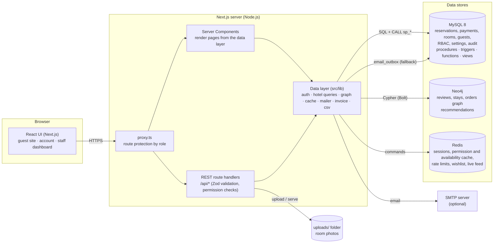
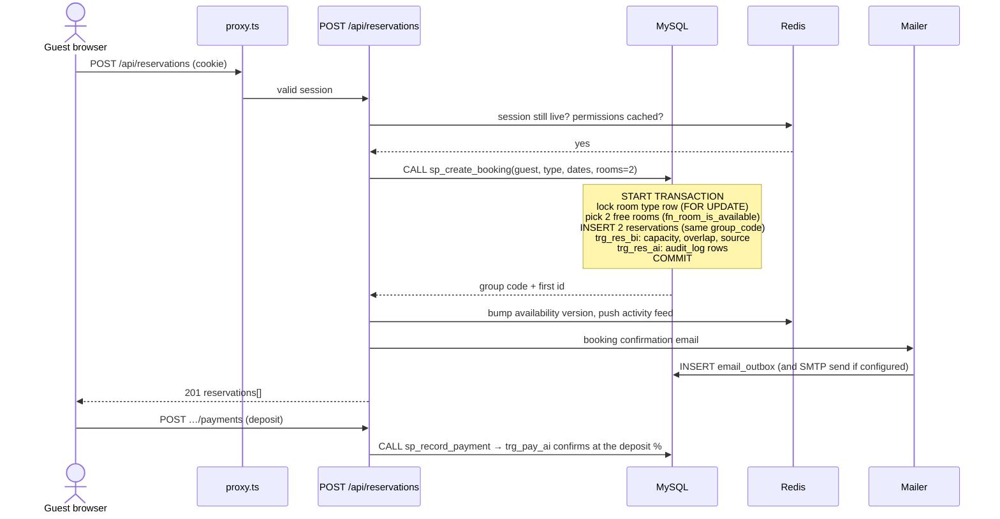
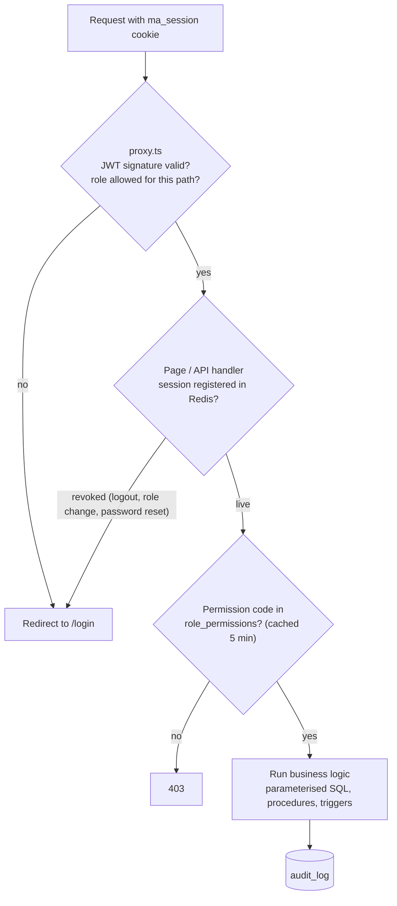
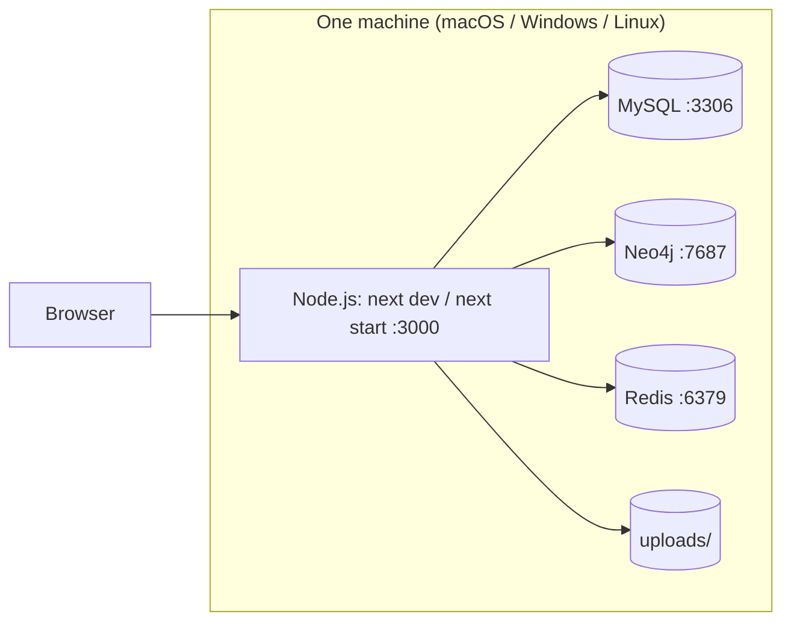

# System Architecture

## 1. Overview

Maison Aurelia is a three-tier web application using **polyglot persistence**: each data store does the job it is best at, and MySQL remains the single source of truth for transactions.



## 2. Layers and responsibilities

| Layer | Technology | Responsibility |
|---|---|---|
| Presentation | Next.js 16 App Router, React 19, Tailwind CSS 4, Framer Motion | Pages and components; Server Components fetch data directly, Client Components handle interaction |
| Edge protection | `src/proxy.ts` (jose) | Redirects visitors without a valid session cookie away from `/dashboard` and `/account` and bounces guests from staff pages |
| API | Route handlers in `src/app/api` (≈40 routes) | Input validation (Zod), permission check (`requirePerm`), orchestration, uniform error format |
| Data access | `src/lib/*` | One module per store: `db.ts` (MySQL pool), `graph.ts` (Neo4j), `cache.ts` (Redis), plus `auth`, `settings`, `mailer`, `invoice`, `csv` |
| Business rules | MySQL stored procedures, functions, triggers | Pricing, availability, deposits, refunds, check-in/out, loyalty, audit — enforced even for access that bypasses the app |
| Persistence | MySQL · Neo4j · Redis | See section 4 |

## 3. Key flow: a guest books two rooms



If any step inside the procedure fails, `ROLLBACK` leaves no partial booking (test T-9).

## 4. Why each data store

| Store | Holds | Why this store |
|---|---|---|
| **MySQL (InnoDB)** | Everything transactional and rule-heavy: accounts, RBAC tables, rooms, reservations, payments, services, housekeeping, settings, audit log | ACID transactions, row locks (no double-booking), foreign keys, CHECK constraints, triggers, stored routines, CTEs and window functions |
| **Neo4j** | `(Guest)-[:WROTE]->(Review)-[:ABOUT]->(RoomType)`, `STAYED_IN`, `ORDERED` | Reviews and "guests like you also…" are relationship queries: two-hop traversals in Cypher, heavy multi-joins in SQL |
| **Redis** | `ma:sess:*` sessions, `ma:perms:*`, `ma:avail:*` caches, rate-limit counters, wishlist hashes, activity feed list | Sub-millisecond access with automatic expiry; keeps ephemeral writes off the system of record |

All Neo4j and Redis helpers degrade to empty results if the store is unreachable, so the booking path (MySQL only) keeps working.

## 5. Security architecture



* Passwords: bcrypt. Session: signed JWT in an `httpOnly`, `sameSite=lax` cookie, plus a Redis registry entry so it can be revoked instantly.
* Secrets come only from environment variables; the app refuses to start with placeholders (`requireEnv`).
* One-time tokens (verification, reset) are stored as SHA-256 hashes and expire.
* The application's MySQL account is localhost-only by default; native MySQL roles (`hotel_admin`, `hotel_staff`, `hotel_guest`) are provisioned for DBA use.

## 6. Deployment view (development / demo)



The three databases can be native installs or Docker containers; only host, port and credentials in `.env.local` differ. Scaling beyond one machine would need shared storage for `uploads/` and a managed MySQL/Redis/Neo4j.

## 7. Project structure

```
db/mysql/   01_schema · 01b_alter_tables · 02_routines · 03_seed · 04_queries · 05_db_roles
db/neo4j/   schema.cypher
src/app/    pages (site, rooms, account, dashboard/*) and api/*
src/lib/    db · cache · graph · auth · settings · hotel · mailer · invoice · csv · env
tests/      booking.test.mjs (database rules) · units.test.mjs
scripts/    setup-db · seed-nosql · run-tests · gen-data-dictionary · take-screenshots
docs/       this documentation set
```
