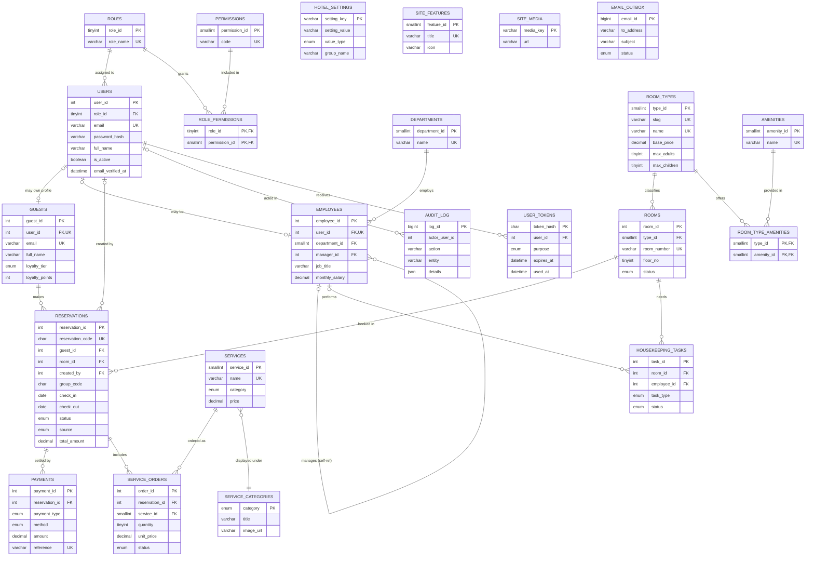

# Entity-Relationship Diagram

Rendered automatically by GitHub / VS Code (Mermaid). Crow's-foot notation:
`||` exactly one · `o|` zero or one · `o{` zero or many · `|{` one or many.

## Cardinalities explained

| Relationship | Cardinality | Why |
|---|---|---|
| ROLES → USERS | 1 : N | Every account has exactly one role |
| ROLES ↔ PERMISSIONS | M : N via `role_permissions` | A role bundles many permissions; a permission belongs to many roles |
| USERS → GUESTS | 1 : 0..1 | Walk-in guests have no online account |
| USERS → EMPLOYEES | 1 : 0..1 | Not every employee has a system login |
| EMPLOYEES → EMPLOYEES | 1 : N (recursive) | `manager_id` builds the reporting hierarchy |
| ROOM_TYPES ↔ AMENITIES | M : N via `room_type_amenities` | Amenity matrix per room category |
| GUESTS → RESERVATIONS | 1 : N | A guest can book many stays |
| ROOMS → RESERVATIONS | 1 : N | A room is booked many times (never overlapping, enforced by trigger) |
| RESERVATIONS → PAYMENTS | 1 : N | Deposit, balance and refunds |
| RESERVATIONS → SERVICE_ORDERS | 1 : N | Spa, dining and transport added to the folio |
| RESERVATIONS ↔ RESERVATIONS | grouped by `group_code` | The rooms of one multi-room booking share a code (booked atomically by `sp_create_booking`) |
| USERS → USER_TOKENS | 1 : N | One-time password-reset and email-verification tokens (hash only) |

`hotel_settings`, `site_features`, `service_categories` and `site_media` hold configuration and website content (policies, copy, images). `service_categories.category` is the same ENUM as `services.category`, so the join is by value, not a foreign key.

The graph (Neo4j) and key-value (Redis) models are documented in [NOSQL.md](NOSQL.md).
